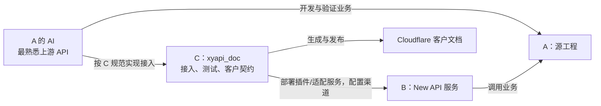

# A → C → New API / 客户文档：执行 SOP

## 固定称呼与分工

**C 是本仓库：接入与文档中心 G:/workspace/xyapi_doc。** A 是实现功能的源工程；B 是正在运行的 New API 服务，不是另一个必须交接的工程或 AI。

| 对象 | 负责什么 | 实际维护位置 |
| --- | --- | --- |
| A：源工程 | 业务功能、内部 API、业务部署和测试 | 各源工程，例如 G:/workspace/vidu2api |
| B：New API 服务 | 运行客户鉴权、渠道路由、计费和任务插件 | https://openai.2yanx.dpdns.org |
| C：接入与文档中心 | 接入代码、客户契约、验收记录、站点生成和发布 | G:/workspace/xyapi_doc |

**默认由 A 的 AI 同时完成 A 的业务与 C 的接入交付。** C 的维护 AI负责公共规则、共享配置协调和汇总发布；只有上下文不足或工作确需移交时才用交付记录交接。你无需手填 JSON 或在两个工程复制客户文档。



客户实际调用：**客户 → B → A → B → 客户**。C 的在线调试使用本站 /api-proxy 转发到 B，仍经过客户鉴权与正常计费。

## 第一步：A 的 API 已调通，让 A 的 AI 读 C 的入口

A 技术规范在 [docs/integration/README.md](../integration/README.md)：遇到未知 New API 行为按对应版本源码研究，接入方式、渠道字段、业务决定和交付材料均有明确入口。C 先读 [projects/README.md](../../projects/README.md) 找该 A 的身份、上游、研究、接入与验收记录。新项目使用 templates/source-project/，本次项目为 vidu2api。

把 [A 的任务说明](../../templates/ai-upstream-task.md) 发给 A，或者直接要求它读取 C 的 [START_HERE.md](../../START_HERE.md)。该说明已经要求完成接入和文档，不只交一份上游报告。

AI 核对 A 的实际路由、鉴权、字段、默认值、限制、成功与错误响应、异步/流式流程、部署版本和已有测试。内部接口可以保留 A 自己的说明，客户公开契约在 C 维护。

A 本机 API 可用不代表客户经过 B 已可用。不同任务协作依赖保存的代码、规则、版本和记录，不依赖彼此聊天记忆。

## 第二步：A 的 AI 在 C 实现客户接入

先查 C 的 newapi/README.md、sources.json 和现有 integrations，再确定稳定能力 ID，例如 media-image、media-video、file-conversion。

| 情况 | 如何处理 |
| --- | --- |
| 使用任务插件 | 在 C 的 projects/<源工程ID>/newapi/<能力ID>/ 维护插件与测试 |
| 使用内置渠道 | 记录实际渠道/参数/计费配置映射与测试证据，不额外制造插件 |
| 使用独立适配服务 | 在 C 的能力目录维护服务源码与测试，部署到实际运行环境 |
| 新渠道复用相同客户协议 | 复用已有能力、契约和文档，验收内部路由 |
| 非模型计费功能 | 用实际 HTTP 协议，不强行添加 model；清单 models 为 [] |

先明确客户字段与上游字段如何转换、结果和错误如何表达、如何计费，再写实现。客户协议与内部协议可能不同，例如内部返回媒体 URL，客户通过 /content 下载二进制，公开规范必须描述后者。

现有图片/视频的插件和公开文件已从 A 集中到 C。配套流式入口、资产服务和旧操作脚本仍在 A 的位置列于 newapi/README.md；涉及这些行为时核对真实实现，不以插件单元测试覆盖全部入口。

多个 A 的 AI 各改独立能力目录。改来源登记、共用代码和 B 全局配置前核对当前工作；价格/渠道按本次条目合并，不整份覆盖其他能力。

## 第三步：部署到 B，验收真实客户入口和计费

使用 C 的 newapi/load-session.ps1 加载本机加密管理凭证；inspect.ps1 可只读核对现有状态。密钥、原始管理响应和原始客户证据保留 .local/newapi，不进入 Git 或公开文件。

先读 B 当前插件、渠道、模型、价格配置，再在任务已有授权范围内部署和启用。本次修改后记录实际启用版本和源码哈希，不把“文件在 C”或“插件上传成功”写成完整上线。

| 验收项目 | 实际证据 |
| --- | --- |
| 成功调用 | 客户 Key 在公开入口发出的真实请求和脱敏结果 |
| 参数与错误 | 客户参数映射、非法参数、无效 Key 的真实状态码/响应 |
| 长任务 | 创建、查询、结果获取；流式事件、断连后如何查询已有任务 |
| 计费 | 成功调用账单变化、单位、扣费时机、失败/取消扣费或退款 |
| 部署版本 | A 业务部署版本、B 实际启用接入版本/源码哈希及验收时间 |

沿用已授权凭证与测试额度。没有真实验证条件时完成可验证的实现与本地预览，明确“待验证”及缺少的条件。模拟成功、管理员 dry-run、401 或源码 push 均不能替代成功业务与账单验收。

长任务按已实现的异步或流式方案交付；不要在客户超时后盲目重复创建。固定价格数字需有当前公开配置依据，历史价格不能冒充最新售价。

## 第四步：同一 AI 在 C 写好客户公开文件

每项能力在 projects/<源工程ID>/newapi/<能力ID>/ 维护：

| 文件 | 作用 |
| --- | --- |
| public-openapi.json | 客户路径、方法、鉴权、参数、响应、错误和请求示例 |
| public-guide.zh.md | 中文流程、限制、模型差异、计费语义与完整示例 |
| public-guide.en.md | 同版本英文指南 |
| public-docs.json | 能力 ID、名称、版本、分类、模型与公开文件路径清单 |

**OpenAPI 是 HTTP 接口说明格式，不是 OpenAI。** 所有计费能力都可描述；非模型能力允许 models: []。清单复制 [模板](../../templates/public-docs.json)，由 AI 填写，不让用户手工抄参数。

格式要求：

- OpenAPI 3.1，info.version 与清单 version 一致；每个 operationId 唯一且稳定。
- 使用客户 HTTPS 地址、实际鉴权、操作和响应；$ref 仅规范内部引用。
- 清单路径相对 C 仓库根目录，不能有 ..、磁盘绝对路径或反斜线。
- 中文标题使用 x-title-zh，中文字段说明使用 x-description-zh；两份指南均以一级标题开头。
- 模型名、枚举、category/modelDetails 与真实客户行为一致。分类、分组和选型章节遵循 [模型展示约定](model-catalog-contract.md)，选型章节直接引用指南，禁止复制第二份限制表。
- 当前调试代理使用客户 Bearer Key，支持 GET、POST、PUT、PATCH、DELETE、HEAD。新增鉴权、请求头或方法先扩展并验证代理，不能只写规范后宣布支持。
- 仅清单列出的公开指南和规范被导入。公开文件不能引用未导入本地附件，不能包含内部凭证、渠道密钥、管理入口、成本数据或内部验收证据。

用真实适配器验证公开示例和响应，至少运行 npm test；该命令已包括 C 的图片/视频插件和公开示例校验。新增其他接入类型时接入其实际适配测试。语法通过不能证明业务行为通过。

在 C 的 projects/<源工程ID>/releases/<能力ID>/<版本>.md 按 [交付记录模板](../../templates/api-release-handoff.md) 保存脱敏记录，链接 A 源码与部署证据，填齐 B 验收结果。原始敏感证据留本机忽略目录。

## 第五步：登记一次，生成和检查文档

当前集中能力的登记指向 C 自身：repository 为 dreammis/XINYU_API，ref 为 master，localDirectory 为 "."，manifest 为对应能力的公开清单。首次新增才增加登记，更新已有能力只改原项。

下面仅为格式示例，不代表文件转换能力已经上线：

```json
{
  "id": "file-conversion",
  "repository": "dreammis/XINYU_API",
  "ref": "master",
  "localDirectory": ".",
  "manifest": "projects/your-source/newapi/file-conversion/public-docs.json",
  "category": "tool"
}
```

在 C 执行：

```powershell
# 首次安装依赖时 npm ci；已有依赖无需重复安装。
npm test
npm run docs:sync
npm run build
npm run docs:check
```

docs:sync 从登记的本机文件导入并记录 SHA、未提交状态与内容哈希；build 使用导入快照。缺文件、哈希或链接错误必须修正来源，不能手改 catalog/gitbook/site 生成结果。

检查中英文能力页、模型目录、接口参数、示例、规范下载与调试代理。客户验收完成后才把新契约发布为可用能力。

## 第六步：发布 C，确认两个部署结果

本地生成后的接入、公开契约、来源登记、catalog/gitbook 等必要结果在同一发布中保持一致。保留其他任务工作，只发布本次文件；禁止 git add . 或把主目录未推送的前端历史整块推送。使用适用的隔离发布工作区或基于远端生产分支准备本次提交。

C 的 master 推送后，Cloudflare 按现有 Git 关联自动构建文档站。确认真实部署成功及客户页面可访问，把文档提交与部署结果回填交付记录。

**B 的插件/适配服务部署和 C 的网站部署是两个结果。** 网站上线不会替你在 B 启用插件、配置渠道或验收计费。回退也要分别核对运行服务与公开契约。

集中到 C 的能力无需在每个 A 配置跨仓库通知 Token，也无需让用户到 C 重新填写文档。A 的 AI 在 C 完成同一批改动即可。

若某能力确实仍由外部接入仓库维护，保留一个唯一公开契约来源，使用原有 docs:sync:remote 和 [通知模板](../../templates/source-docs-sync.yml)。公开来源无需读取 Token；私有来源配置 DOCS_SOURCE_TOKEN；DOCS_DISPATCH_TOKEN 仅用于该外部仓库通知 C。通知接在真实部署与客户验收成功之后，普通源码 push 不等于上线。

## 日常修改与退役

| 变化 | 处理 |
| --- | --- |
| A 内部实现变，客户协议不变 | 在 A 核对并在 C 验证适配兼容性，无需另建客户文档 |
| 新公开模型、参数、限制或响应 | C 同步实现、测试、规范、指南、版本；B 验收后发布 |
| 多个 A 提供相同客户接口 | C 保持一个协议维护位置，内部记录各渠道来源 |
| 客户流程或计费语义不同 | 判断能否在同一契约清楚表达；不能时使用独立能力 ID |
| 价格变化 | 核对 B 当前配置与账单，同步公开价格说明 |
| 下线 | 先安排客户入口下线，再移除登记和共用链接，构建发布 |
| 回退 | A/B 回退运行版本，C 恢复对应已验收契约并重新导入发布 |

同一路径可被多个能力复用，每项能力独立保存规范，避免全局合并覆盖。能力 ID 不等于渠道 ID。

## 本次迁入状态（2026-10-10）

- C 已保存两个插件、测试和中英文客户契约，来源登记改为 C 自身；原 A 副本不再用于本站导入。
- 管理凭证已保存为本机 Windows DPAPI 密文；只读验证成功。
- B 为 v1.0.0-rc.41；media-image 1.2.0、media-video 1.0.0 均启用并 active，源码哈希与 C 一致。
- 本次整理不改 B 的价格、渠道或插件，不新建付费任务；不将历史业务验收写成今天重跑。
- C 新迁入文件尚需按本次实际 Git 发布状态判断远端可读性。本地修改不代表 Cloudflare 已部署。
- 文档 master → Cloudflare 的历史接线记录见 [Cloudflare 维护文档](cloudflare-setup.md)，不把历史成功当成本次部署验证。

维护生成器约定见 [文档工作流](public-docs-workflow.md)，New API 环境与旧配套服务见 [newapi/README.md](../../newapi/README.md)。
